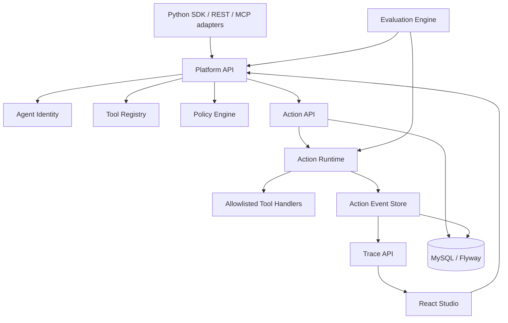

# OwnAgent Engineering Platform

OwnAgent is an open-source engineering platform for building, running, observing, and evaluating AI agents.

It is not intended to replace every agent framework. It provides a durable execution and engineering layer that can host its own focused runtime and accept externally built agents through REST and an early-preview Python SDK.

## Product promise

**Agent decides what to do; OwnAgent makes the action controlled, durable, observable, and honest about its outcome.**

The platform has three product surfaces:

1. **Runtime** — lifecycle, tool execution, state transitions, policy gates, approval, timeout and recovery.
2. **Observability** — structured action events, traces, inputs/outputs, errors, latency and execution history.
3. **Evaluation** — repeatable datasets, evaluators, experiment runs, regression comparison and scorecards.

## Repository responsibilities

| Repository | Responsibility |
| --- | --- |
| `ownsudo` | Java 21 / Spring Boot platform API, persistence, policy and runtime |
| `builder` | React / TypeScript Studio for agents, runs, traces and evaluations |
| `sdk/python` package | Independently installable synchronous Python REST client (early developer preview) |

Python remains an SDK/integration surface. The authoritative Action state and policy decisions live in the Java service.

## Target architecture



## Current implementation boundary

The current feature branch contains:

- Agent API-key authentication and Agent-scoped Action ownership.
- Idempotent Action creation.
- Developer-authenticated Tool Registry metadata and JSON argument validation.
- Deterministic policy decisions: unknown/disabled tools are denied; READ_ONLY/LOW are allowed; MEDIUM/HIGH/CRITICAL require approval.
- An explicit Action execution endpoint for policy-allowed Actions.
- A server-side handler registry. Tool metadata does not make arbitrary code or an endpoint executable.
- Two safe demonstration handlers: `demo.echo` and `text.transform`.
- Persisted Action lifecycle fields and append-only Action event records.
- Per-execution lease token and expiry, with lease-fenced completion to reject stale executors.
- Heartbeat lease renewal while a synchronous handler is active. Renewal requires the same token and an unexpired lease; an expired lease cannot be resurrected.
- Configurable handler timeout. Timed-out or interrupted executions become UNKNOWN, clear the active lease, and emit `ACTION_EXECUTION_UNKNOWN`.
- Scheduled stale-run recovery: expired RUNNING Actions become UNKNOWN and require reconciliation; they are never automatically requeued.
- Agent-scoped Action detail and event APIs.\n- An independently installable Python SDK package (`sdk/python`) for create/execute/get/list/wait/events, with explicit API errors and no automatic execution retries.

The demonstration handlers are intentionally deterministic and local. They prove the runtime lifecycle without enabling arbitrary shell, SQL, network, or filesystem execution.

## Action lifecycle

```text
POST /api/v1/actions
  ├── DENY             -> DENIED
  ├── REQUIRE_APPROVAL -> PENDING_APPROVAL
  └── ALLOW            -> READY
                           |
                           | POST /api/v1/actions/{id}/execute
                           v
                         RUNNING (lease + heartbeat)
                         /     |      \\
                   SUCCEEDED FAILED  UNKNOWN
```

Only Actions with both `decision=ALLOW` and `status=READY` can be claimed. A claim persists a random lease token and expiry; completion must present the same token before expiry. The claim and terminal state transitions are persisted in separate transactions. An optimistic version column prevents two concurrent requests from both claiming the same Action. Tool handler code runs outside the database transaction.

A heartbeat extends the current lease while the handler runs. The default lease is 300 seconds and the default heartbeat interval is 10 seconds. Both are configurable; keep the heartbeat interval comfortably shorter than the lease duration. The renewal transaction verifies the Agent, Action, RUNNING status, token and current expiry before extending the deadline.

The default handler timeout is 60 seconds. On timeout, OwnAgent interrupts the virtual thread and records UNKNOWN rather than FAILED. Java interruption is cooperative, not a hard process kill: a handler may ignore interruption and an external side effect may still complete. The old lease token is invalidated, so a late handler cannot overwrite the persisted Action outcome. Operators must reconcile the external system before retrying.

A scheduled recovery task scans expired RUNNING leases. It marks those Actions `UNKNOWN`, records `EXECUTION_LEASE_EXPIRED`, and emits `ACTION_LEASE_EXPIRED`. It deliberately does not return them to READY: after a process crash, an external side effect may already have happened. Manual reconciliation is required before any retry.

A handler that is not installed fails explicitly with `TOOL_HANDLER_NOT_FOUND`; it is never treated as successful merely because metadata exists.

## API slice

- `POST /api/v1/actions` — create an idempotent Action and evaluate policy.
- `GET /api/v1/actions` — list the authenticated Agent's Actions.
- `GET /api/v1/actions/{id}` — fetch one owned Action.
- `POST /api/v1/actions/{id}/execute` — claim and execute an ALLOW/READY Action.
- `GET /api/v1/actions/{id}/events` — fetch persisted lifecycle events.
- `POST /api/v1/tools` — register tool metadata (requires Agent key and developer tool-admin key).
- `GET /api/v1/tools` — list the authenticated Agent's tool metadata.

All `/api/v1/**` requests require an Agent Bearer API key. Tool registration additionally requires `X-OwnAgent-Tool-Admin-Key`.

## Next milestones

1. **Developer execution:** Local Worker protocol, custom Python handlers and approval-to-execution flow. The synchronous REST Python SDK exists as an early developer preview.
2. **Runtime hardening:** worker leases, cancellation, manual reconciliation workflow, safe retry semantics and outbox-based worker dispatch.
3. **Observability:** span model, parent-child relationships, LLM call metadata, redaction, streaming events and trace visualization.
4. **Evaluation:** versioned datasets, deterministic evaluators, experiment runs, baseline comparison and regression gates.
5. **Studio:** Agent registry, run explorer, trace waterfall, evaluation workbench and reproducible demos.

## Explicit non-goals for the focused release

- No arbitrary code execution from Tool Registry metadata.
- No unrestricted shell, SQL, filesystem, or HTTP tool.
- No claim of exactly-once execution for external side effects.
- No claim that configured risk levels alone form a complete authorization model.
- No claim of production-grade distributed scheduling until worker coordination, recovery and reconciliation are implemented.
