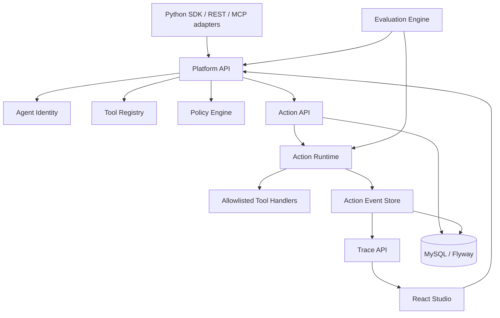

# OwnAgent Engineering Platform

OwnAgent is an open-source engineering platform for building, running, observing, and evaluating AI agents.

It is not intended to replace every agent framework. It provides a durable execution and engineering layer that can host its own focused runtime and accept externally built agents through REST and a Python SDK.

## Product promise

**Build agents that can be inspected, evaluated, and operated reliably.**

The platform has three product surfaces:

1. **Runtime** — lifecycle, tool execution, state transitions, policy gates, approval, timeout and recovery.
2. **Observability** — structured action events, traces, inputs/outputs, errors, latency and execution history.
3. **Evaluation** — repeatable datasets, evaluators, experiment runs, regression comparison and scorecards.

## Repository responsibilities

| Repository | Responsibility |
| --- | --- |
| `ownsudo` | Java 21 / Spring Boot platform API, persistence, policy and runtime |
| `builder` | React / TypeScript Studio for agents, runs, traces and evaluations |
| Future `ownagent-python` | Python SDK and adapters for external Agent implementations |

Python remains an SDK/integration surface. The authoritative Action state and policy decisions live in the Java service.

## Target architecture



## Current implementation boundary

The current feature branch contains:

- Agent API-key authentication and Agent-scoped Action ownership.
- Idempotent Action creation.
- Developer-authenticated Tool Registry metadata and JSON argument validation.
- Deterministic policy decisions: unknown/disabled tools are denied; READ_ONLY/LOW are allowed; MEDIUM/HIGH/CRITICAL require approval.
- An explicit Action execution endpoint for policy-allowed Actions.
- A server-side handler registry. Tool metadata does not make arbitrary code or an endpoint executable.
- Two safe demonstration handlers: `demo.echo` and `text.transform`.
- Persisted Action lifecycle fields and append-only Action event records.
- Agent-scoped Action detail and event APIs.

The demonstration handlers are intentionally deterministic and local. They prove the runtime lifecycle without enabling arbitrary shell, SQL, network, or filesystem execution.

## Action lifecycle

```text
POST /api/v1/actions
  ├── DENY             -> DENIED
  ├── REQUIRE_APPROVAL -> PENDING_APPROVAL
  └── ALLOW            -> READY
                           |
                           | POST /api/v1/actions/{id}/execute
                           v
                         RUNNING
                         /     \\
                   SUCCEEDED   FAILED
```

Only Actions with both `decision=ALLOW` and `status=READY` can be claimed. The claim and terminal state transitions are persisted in separate transactions. An optimistic version column prevents two concurrent requests from both claiming the same Action. Tool handler code runs outside the database transaction.

A handler that is not installed fails explicitly with `TOOL_HANDLER_NOT_FOUND`; it is never treated as successful merely because metadata exists.

## API slice

- `POST /api/v1/actions` — create an idempotent Action and evaluate policy.
- `GET /api/v1/actions` — list the authenticated Agent's Actions.
- `GET /api/v1/actions/{id}` — fetch one owned Action.
- `POST /api/v1/actions/{id}/execute` — claim and execute an ALLOW/READY Action.
- `GET /api/v1/actions/{id}/events` — fetch persisted lifecycle events.
- `POST /api/v1/tools` — register tool metadata (requires Agent key and developer tool-admin key).
- `GET /api/v1/tools` — list the authenticated Agent's tool metadata.

All `/api/v1/**` requests require an Agent Bearer API key. Tool registration additionally requires `X-OwnAgent-Tool-Admin-Key`.

## Next milestones

1. **Runtime hardening:** worker leases, cancellation, timeout enforcement, safe retry semantics, stale RUNNING recovery and outbox-based dispatch.
2. **Observability:** span model, parent-child relationships, LLM call metadata, redaction, streaming events and trace visualization.
3. **Evaluation:** versioned datasets, deterministic evaluators, experiment runs, baseline comparison and regression gates.
4. **Python SDK:** typed Action client, idempotency helpers, polling/waiting and adapters for external agent frameworks.
5. **Studio:** Agent registry, run explorer, trace waterfall, evaluation workbench and reproducible demos.

## Explicit non-goals for the focused release

- No arbitrary code execution from Tool Registry metadata.
- No unrestricted shell, SQL, filesystem, or HTTP tool.
- No claim of exactly-once execution for external side effects.
- No claim that configured risk levels alone form a complete authorization model.
- No claim of production-grade distributed scheduling until leases, recovery and worker coordination are implemented.
